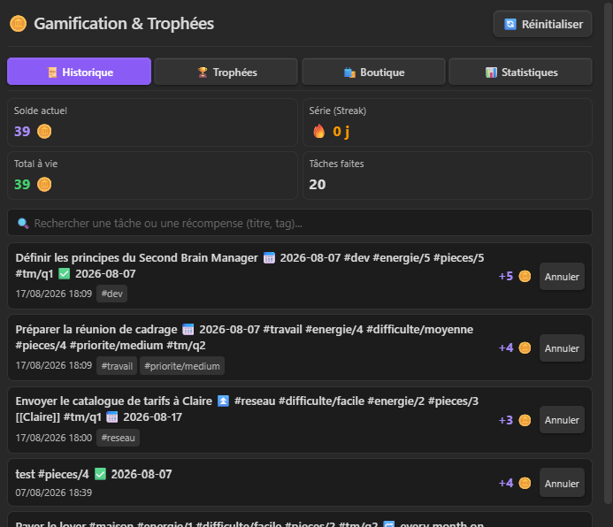
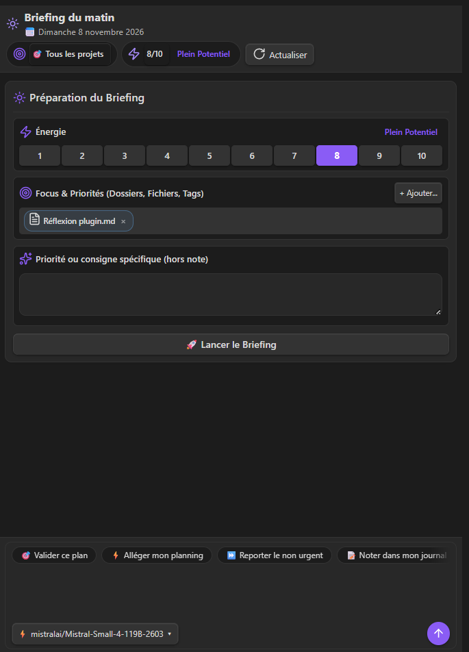
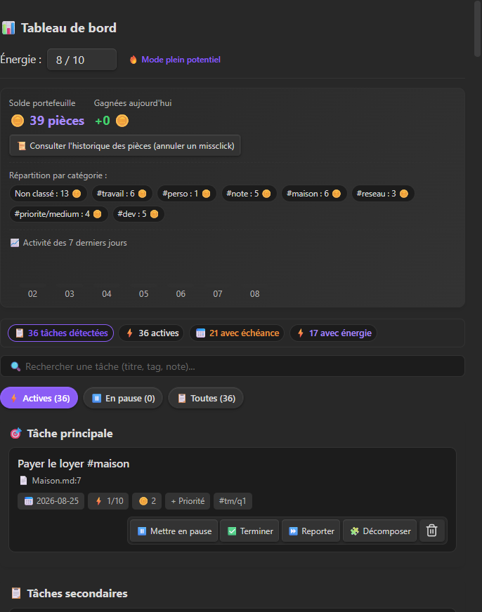
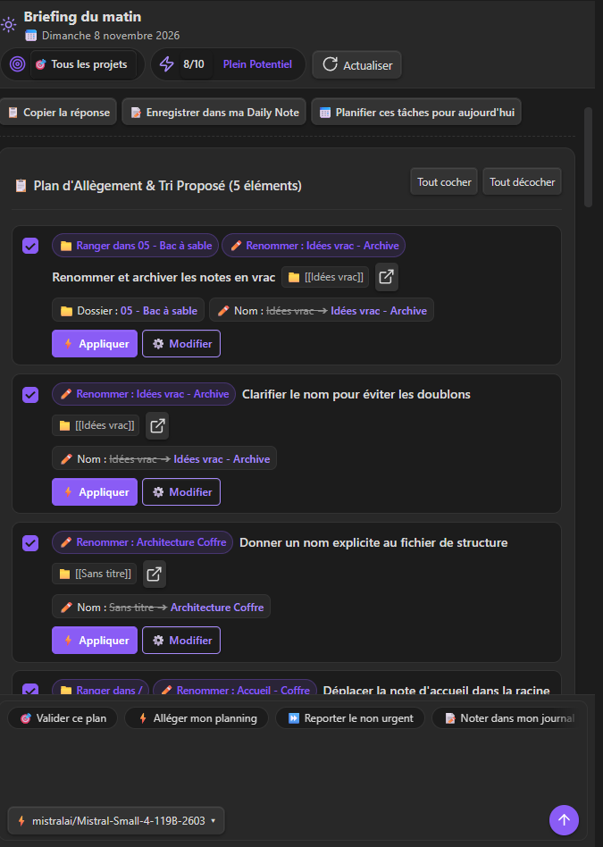
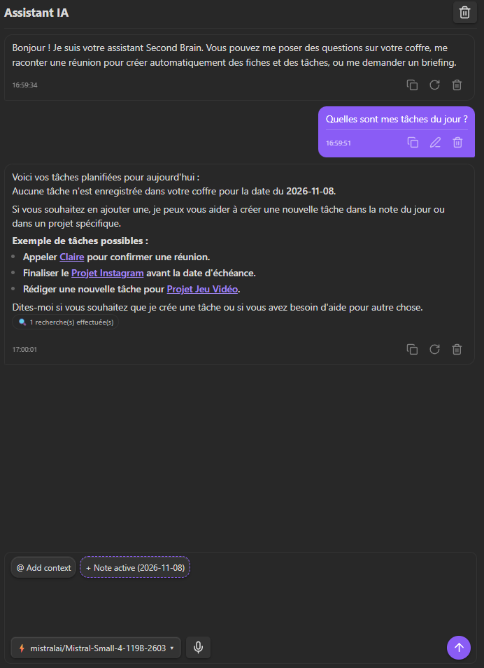
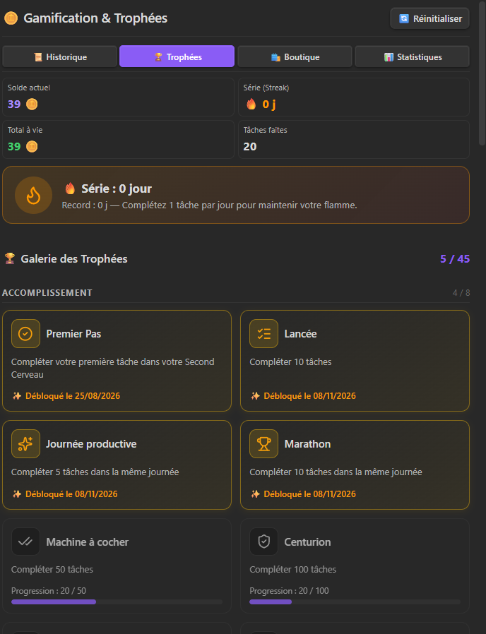
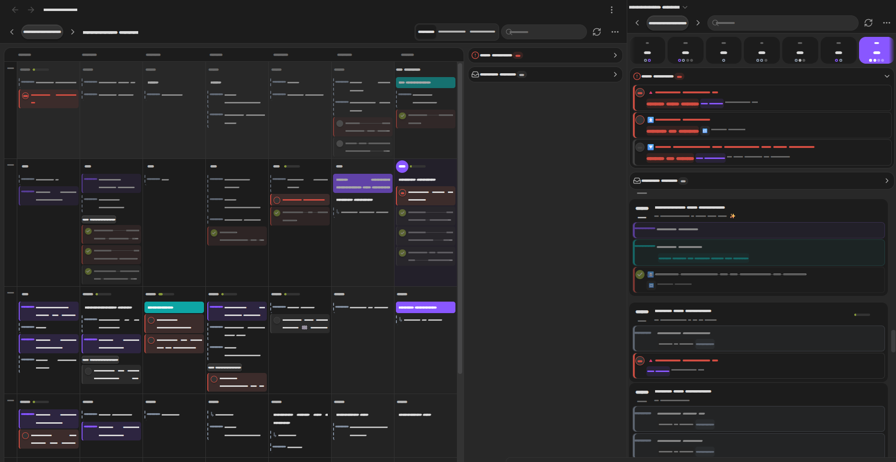

# Second Brain Manager — Plugin Obsidian

> **Un orchestrateur agentique, gamifié et intelligent pour votre coffre Obsidian.**
> Compatible nativement avec Obsidian Tasks, la matrice d'Eisenhower et les modèles de langage (LLM).

---

## 🌟 Fonctionnalités Principales

- **Tâches 100% Markdown & Standard Obsidian Tasks** :
  - Parsing complet des échéances (`📅`), dates de début (`🛫`), planifiées (`⏳`), récurrences (`🔁`).
  - Tags normalisés : `#energie/1-10`, `#difficulte/...`, `#pieces/N`, `#domaine/...`, `#contexte/...`.
  - Tags Unicode : accents et caractères non latins reconnus partout (`#ménage`, `#santé`, `#日本`).
  - Mode de priorité configurable : Emojis Tasks (`🔺 ⏫ 🔼 🔽 ⏬`) ou tags hiérarchiques (`#priorite/haute`).
  - **Statuts personnalisés du plugin Tasks** : les statuts (`[/]`, `[-]`, `[>]`…), leurs types (à faire, en cours, terminée, annulée, en attente) et le filtre global sont lus directement dans les réglages de Tasks.
  - Bouton de suppression d'une tâche sur les cartes, le tableau de bord et les aperçus d'actions IA.

- **Matrice d'Eisenhower optionnelle** :
  - Compatibilité via `MatrixAdapter` (TaskMatrix `#tm/q1..4`, Focus First, Custom tags).
  - Interrupteur « Activer les quadrants » : désactivée, la matrice disparaît partout (cartes, tableau de bord, prompts et outils de l'IA, barème de pièces, trophées).
  - Les sous-tâches gardent leur indentation lors d'un changement de quadrant.

- **Exclusion de tâches** :
  - Tâches ignorées dans toutes les vues et requêtes (tableau de bord, calendrier, briefing, revue du soir, reprise, recherches de l'IA).
  - Règles par tags (sous-tags et tags de note inclus), mots ou expressions régulières, dossiers / fichiers (avec jokers `*`) et statuts.
  - Bouton « Tester les règles » pour voir immédiatement les tâches exclues.

- **Calendrier unifié tâches + Google Agenda (`TaskCalendarView`)** :
  - Vues Jour, Semaine, Mois et Agenda continu (défilement fluide), dans la barre latérale ou la zone principale.
  - Tâches et événements Google réunis, plusieurs agendas avec couleurs, dédoublonnage des événements présents dans plusieurs agendas.
  - Glisser-déposer pour replanifier, menus contextuels, ajout rapide d'une tâche ou d'un événement.
  - Bacs « En retard » et « Sans date » fixés en haut de la barre latérale.
  - Vue Mois : toutes les tâches restent visibles, seuls les événements en surnombre sont repliés.

- **Gamification & Portefeuille de Pièces d'Or** :
  - Écouteur automatique de complétion de tâches (`app.vault.on('modify')`).
  - Portefeuille persistant avec détection d'unicité et barème automatique ou explicite.
  - Les anciennes tâches déjà cochées (date ✅ passée) ne sont jamais recomptées, même quand des lignes sont ajoutées dans la note.
  - **45 trophées** regroupés par famille (régularité, volume, moments de la journée, effort, variété, matrice, boutique…), calculés rétroactivement.
  - **Boutique de récompenses** : échangez vos pièces contre les récompenses de votre catalogue (achat confirmé en deux clics, annulation possible).
  - Historique unique des tâches validées et des récompenses échangées, avec recherche et annulation / remboursement en cas de missclick.
  - Statistiques avancées avec graphiques vectoriels SVG natifs zéro-dépendance (Courbe 14 jours, Camembert Donut, Barres journalières).

- **Tableau de Bord Interactif (`DashboardView`)** :
  - Jauge d'énergie (1 à 10) et bascule de mode Économie vs Pleine Énergie.
  - 4 sections de triage : Aujourd'hui & Urgences, Recommandées selon énergie, Non classées, Boîte de réception Inbox.
  - Barre de recherche en temps réel et popover de changement de priorité.

- **Briefing du matin** :
  - Zone de réponse identique à celle du chat pour dialoguer avec l'assistant pendant le briefing.

- **Assistant IA Conversationnel & Streaming en Temps Réel (`ChatView`)** :
  - Multi-fournisseurs : Google Gemini (1.5 / 2.0 Flash / Pro), OpenAI ChatGPT (GPT-4o), Ollama & LM Studio (Local).
  - Déroulement fluide mot à mot (Typewriter Queue à 16ms) avec curseur actif (`▌`).
  - Rendu Markdown soigné et compact.
  - Prompt de correction qui corrige le texte sans jamais le surligner ni le mettre en forme.

- **Interface** :
  - Densité réglable (Confortable, Compacte, Très compacte) appliquée à toutes les vues du plugin.
  - Vues de la barre latérale ouvertes automatiquement au démarrage (au choix).

- **Paramètres Natifs & Secret Storage** :
  - Architecture modulaire inspirée du plugin officiel *Spaced Repetition* (`SettingsPageManager`).
  - Réglages déclaratifs regroupés par section, avec **barre de recherche** pour retrouver un réglage instantanément.
  - Navigation 100% accessible au clavier (`Tab`, `Entrée`, `Espace`).
  - Intégration officielle de l'API `SecretStorage` d'Obsidian pour sécuriser les clés d'API.

---

## Screenshots










## 🚀 Installation & Développement

```bash
# Installation des dépendances
npm install

# Lancer la compilation en mode développement
npm run dev

# Vérification du typage et du code
npm run lint

# Exécuter les tests unitaires
npx vitest run

# Compiler pour la production
npm run build
```

---

## 📜 Licence

MIT License.
